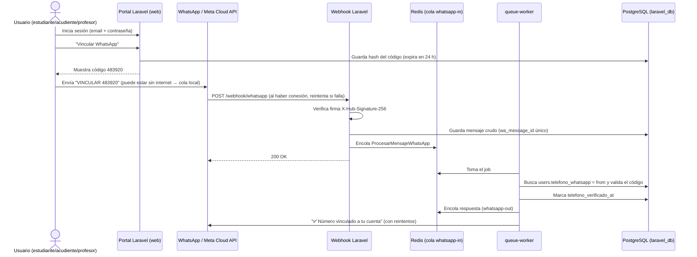

# Contexto del proyecto — Hackathon InfraTech: San Luquitas Digital

> Documento de contexto compartido para el equipo y para sus asistentes de IA (Claude, ChatGPT, Copilot, Gemini, Cursor…).
> Léelo completo antes de proponer código, comandos o documentación. Si una decisión cambia, **actualiza este archivo**.

---

## 0. Resumen rápido (TL;DR para IAs)

- **Qué es:** actividad evaluativa final de la asignatura *Infraestructura Tecnológica*. Somos una "empresa consultora" que diseña, despliega, documenta y sustenta la infraestructura de la **IE San Luquitas** (colegio rural colombiano ficticio).
- **Qué se evalúa:** la **infraestructura** (Linux, Docker, redes, BD, seguridad, persistencia, respaldo, documentación, sustentación). La complejidad del código **no** da puntos extra.
- **Dos aplicaciones obligatorias:**
  1. **Moodle** → LMS "San Luquitas Digital" con el curso "Mis primeros pasos en programación".
  2. **Laravel** → "Portal Institucional San Luquitas", **obligatoriamente en Docker**.
- **Valor agregado del equipo:** **bot de WhatsApp** para que estudiantes, acudientes y profesores registren tareas pendientes, aunque no tengan internet en ese momento. Los mensajes pasan por una **cola Redis** y se guardan en la BD del Portal, que tiene un **panel visual de tareas**.
- **Stack elegido:** Ubuntu Server 24.04 LTS · Docker + Docker Compose (todo contenerizado, "monolito estructurado") · Nginx · PHP-FPM 8.3 · Moodle 5.x · Laravel 12 · PostgreSQL 16 · Redis 7 · WhatsApp Cloud API (Meta) · Cloudflare Tunnel.
- **Reglas de oro:**
  1. Solo **datos ficticios**. Nunca datos reales de menores.
  2. **Nunca** commitear secretos (`.env`, tokens de Meta, contraseñas). Solo `.env.example`.
  3. Cada aplicación tiene **su propia base de datos lógica y su propio usuario** de BD.
  4. Todo debe ser **reproducible** y quedar **documentado** (comandos comentados + explicación).
  5. Todo uso de IA se registra en la tabla de la sección 13.
  6. Interfaz, documentación y comentarios en **español**.

---

## 0.1 Equipo, responsables y ramas

| # | Integrante | Bloque | Rama | Tareas detalladas |
|---|---|---|---|---|
| 1 | Alejandro Jimenez | Servidor, red, seguridad y sustentación | `alejandro-jimenez/servidor-red-seguridad` | `.claude/tareas/1-alejandro-jimenez.md` |
| 2 | Julian Godoy | Moodle, EVA y documento PDF | `julian-godoy/moodle-eva-documento` | `.claude/tareas/2-julian-godoy.md` |
| 3 | Alejandro Moreno | Infraestructura Docker, Portal base y respaldo | `alejandro-moreno/docker-portal-respaldo` | `.claude/tareas/3-alejandro-moreno.md` |
| 4 | Samuel Guzmán | Usuarios, tareas y bot de WhatsApp | `samuel-guzman/usuarios-tareas-bot` | `.claude/tareas/4-samuel-guzman.md` |

- Cada archivo de tareas existe **solo en la rama de su dueño**. Si eres una IA trabajando en una de esas ramas, lee primero ese archivo: define el alcance de tu trabajo.
- No modifiques archivos que pertenecen a otro integrante sin coordinarlo. Los cambios se integran a `main` mediante Pull Request.
- Se trabaja en la rama propia; `main` solo recibe merges revisados.

---

## 1. Propósito de la actividad

Hackathon para diseñar, implementar, configurar, documentar y sustentar la infraestructura de un **Entorno Virtual de Aprendizaje (EVA)** con Moodle y una **aplicación web institucional** en Laravel para la IE San Luquitas.

Integra lo visto en el curso: servidores Linux, servicios web, bases de datos, Docker, redes, seguridad básica, almacenamiento, persistencia, respaldo, documentación técnica y decisiones de arquitectura.

- El EVA enseña programación y pensamiento computacional a niños de básica primaria (4.º–5.º).
- El énfasis está en la infraestructura que soporta las aplicaciones: funcionamiento, integración, administración, seguridad, persistencia, respaldo y justificación técnica.

## 2. Escenario

- La IE San Luquitas está en zona **rural colombiana**, con poca conectividad y pocos recursos tecnológicos.
- Necesita un EVA para introducir a los niños en la programación y un portal web para centralizar información, novedades, recursos y el acceso al EVA.
- La solución debe poder **operar en red local**, **depender poco de internet** y garantizar **disponibilidad y recuperación** de la información.
- Es un caso **académico de laboratorio**: información ficticia, sin sistemas reales.

## 3. Reto general

Cada equipo instala y administra un servidor Linux, configura los servicios, implementa Docker, despliega Moodle y Laravel, configura sus BD y demuestra que todo funciona con una arquitectura coherente.

- SO permitidos: Fedora Server, Ubuntu Server o Debian.
- Servidores web: Apache o Nginx. BD: MySQL, MariaDB o PostgreSQL.
- Toda elección debe estar **técnicamente justificada**.
- Al final: demostrar ambas aplicaciones, documentar la arquitectura y sustentar por qué es adecuada.

---

## 4. Requisitos técnicos mínimos

| Componente | Requisito mínimo | Cómo lo cumplimos |
|---|---|---|
| Sistema operativo | Fedora Server, Ubuntu Server o Debian en VM | Ubuntu Server 24.04 LTS en VirtualBox |
| Servidor web | Apache o Nginx | Nginx en contenedor (reverse proxy + FastCGI a PHP-FPM) |
| Moodle | LMS funcional con BD, recursos, actividades y usuarios | Moodle 5.x en contenedor PHP-FPM 8.3 |
| Laravel | App institucional desplegada con Docker | Laravel 12 en contenedor PHP-FPM 8.3 |
| Docker | Contenedores para Laravel y servicios | Docker Engine + `compose.yaml` único |
| BD Moodle | Motor relacional compatible | PostgreSQL 16 → `moodle_db` / `moodle_user` |
| BD Laravel | MySQL, MariaDB o PostgreSQL conectada | PostgreSQL 16 → `laravel_db` / `laravel_user` |
| Red | IP, puertos, conectividad, acceso desde otro equipo | IP estática en LAN, puertos 80/443, hosts `*.sanluquitas.local` |
| Almacenamiento | Persistencia de BD y archivos | Volúmenes Docker con nombre |
| Seguridad | Usuarios, permisos, firewall, credenciales | UFW, usuario no root, `.env` protegido, redes internas |
| Respaldo | Copias y prueba de recuperación | `scripts/backup.sh` + `scripts/restore.sh` + cron |
| Administración | Iniciar, detener, reiniciar, estado, logs | `docker compose up/down/restart/ps/logs`, `systemctl` |

### Modalidad de despliegue elegida: **Contenerizada**

El enunciado ofrece tres modalidades: Tradicional + Docker, Contenerizada o Híbrida. Elegimos **Contenerizada**: Moodle, Laravel, PostgreSQL, Redis, Nginx y el túnel corren en Docker, definidos en un solo `compose.yaml`. Lo llamamos **monolito estructurado**: se despliega como una sola unidad, pero cada servicio tiene su propio contenedor, red, volumen y credenciales.

Requisitos que el enunciado pide verificar:
- **Moodle 5.x requiere PHP ≥ 8.3** y PostgreSQL ≥ 14 (cumplimos con PHP 8.3 y PG 16). Extensiones PHP necesarias: `pgsql`, `intl`, `zip`, `gd`, `soap`, `xml`, `mbstring`, `curl`, `opcache`, `sodium`, `exif`. Además `max_input_vars ≥ 5000`.
- **Laravel 12 requiere PHP ≥ 8.2** (usamos 8.3). Extensiones: `pdo_pgsql`, `redis` (phpredis), `mbstring`, `bcmath`, `intl`, `zip`.
- Moodle y Laravel deben correr **a la vez sin conflictos de puertos**. Por eso Nginx es el único servicio que publica puertos y separa el tráfico por nombre de host.

---

## 5. Requisitos del EVA en Moodle — "San Luquitas Digital"

Curso: **"Mis primeros pasos en programación"** (4.º o 5.º de primaria).

| Componente | Requisito mínimo |
|---|---|
| Presentación | Nombre del curso, descripción, población destinataria y objetivos |
| Unidad 1 | Introducción al pensamiento computacional: secuencias y patrones |
| Unidad 2 | Algoritmos cotidianos: instrucciones y resolución de problemas |
| Unidad 3 | Programación visual: primeros pasos con Scratch o similar |
| Recursos | Mínimo 3 (páginas, documentos, imágenes, videos o enlaces) |
| Actividad evaluativa | Mínimo 1 cuestionario o tarea |
| Comunicación | 1 foro o espacio de interacción |
| Usuarios | Administrador, docente y mínimo 3 estudiantes ficticios matriculados |
| Roles y permisos | Evidencia de accesos y funciones diferentes según el usuario |
| Identidad visual | Nombre de la institución, presentación del sitio y personalización básica |

Se permite crear contenidos con IA. No se evalúa la profundidad pedagógica, sino la configuración y el funcionamiento de Moodle como servicio.

Sugerencia de usuarios de prueba (ficticios): `admin`, `docente.martha`, `est.ana`, `est.juan`, `est.sofia`.

---

## 6. Requisitos de la app Laravel — "Portal Institucional San Luquitas"

| Módulo | Requisito mínimo |
|---|---|
| Página principal | Presentación general de la IE (ficticia) |
| Información institucional | Presentación, descripción y datos generales |
| Novedades | Registrar, consultar y actualizar noticias y comunicados (CRUD básico) |
| Recursos educativos | Recursos o enlaces sobre enseñanza de programación |
| Acceso a Moodle | Enlace funcional a San Luquitas Digital |
| Base de datos | Almacenamiento persistente de novedades y registros |
| Funcionalidad dinámica | Demostrar registro y consulta desde la web |
| Despliegue | Laravel ejecutándose en Docker |
| Administración | Evidencia de configuración, logs, conectividad y contenedores |

No son obligatorios la autenticación avanzada, los múltiples perfiles ni la integración por API con Moodle. **Nosotros sí agregamos login con roles**, porque el bot de WhatsApp lo necesita (ver sección 7).

---

## 7. Extensión del equipo: bot de tareas por WhatsApp

### 7.1 Idea

Estudiantes, acudientes (padres) y profesores le escriben a un número de WhatsApp de la institución para **registrar tareas pendientes**. Las tareas se guardan en la BD del Portal y se ven en un **panel visual** (`/tareas`).

### 7.2 Por qué funciona sin internet (offline-first)

1. El usuario escribe al bot **aunque su teléfono no tenga internet**. WhatsApp deja el mensaje en la cola local del teléfono (aparece con el ícono del reloj).
2. Cuando el teléfono recupera la conexión, WhatsApp entrega el mensaje a los servidores de Meta.
3. Meta envía el mensaje al **webhook** del colegio. Si el servidor del colegio tampoco tiene internet en ese momento, **Meta reintenta la entrega durante un tiempo (hasta ~7 días)**.
4. El webhook entra al servidor por **Cloudflare Tunnel**. El contenedor `cloudflared` abre una conexión saliente, así que no hay que abrir puertos en el router ni tener IP pública.
5. Laravel valida la firma, guarda el mensaje "crudo" y lo **encola en Redis**. Responde `200 OK` de inmediato para que Meta no reintente.
6. El contenedor `queue-worker` procesa la cola: identifica al usuario, interpreta el mensaje y crea la tarea en PostgreSQL.
7. La respuesta de confirmación también se encola (`whatsapp-out`) con **reintentos y espera progresiva (backoff)**. Si el colegio pierde internet, se envía cuando vuelva.

**Idempotencia:** el `wa_message_id` de cada mensaje es único en la tabla `mensajes_whatsapp`. Si Meta reenvía el mismo mensaje, no se duplica la tarea.

### 7.3 Identificación y login: cómo sabe el bot quién escribe

- Cada mensaje de la Cloud API trae el número del remitente (`from` / `wa_id`), **verificado por WhatsApp**. Ese número se usa para buscar al usuario en `users.telefono_whatsapp` (formato E.164, ej. `+573001234567`).
- **Login web** en el Portal (Laravel Breeze; sesiones en Redis) con 4 roles: `admin`, `profesor`, `acudiente`, `estudiante`.
- **Alta de usuarios:** el admin (secretaría) crea las cuentas con datos ficticios, vincula acudientes con estudiantes (`acudiente_estudiante`) y asigna materias y grados a los profesores.
- **Vinculación del número en 2 pasos (evita suplantaciones):**
  1. El usuario inicia sesión en el Portal → "Vincular WhatsApp" → el sistema genera un **código de 6 dígitos** (guardado con hash y válido 24 h).
  2. El usuario envía al bot `VINCULAR 483920`.
  3. El worker comprueba que el número coincide con el del usuario y que el código es válido, y marca `telefono_verificado_at`.
  - Como el código dura 24 h, sirve aunque el mensaje llegue tarde por falta de internet.
- **Número desconocido o sin verificar:** no se crea ninguna tarea. El bot responde *"Tu número no está registrado. Pide acceso en secretaría o vincúlalo desde el portal."* y el mensaje queda en `mensajes_whatsapp` con estado `rechazado` (auditoría).



### 7.4 Permisos por rol

| Rol | Por WhatsApp | En el panel web `/tareas` |
|---|---|---|
| Estudiante | Crear y consultar **sus** tareas | Ver y marcar sus tareas |
| Acudiente | Crear y consultar tareas de **sus hijos**. Si tiene varios: `TAREA @Ana ...` (si no lo indica, el bot pregunta) | Ver las tareas de sus hijos |
| Profesor | Asignar una tarea a un grado: `TAREA GRADO 5 Ciencias \| ...` | Ver y crear tareas de sus grados |
| Admin | — (solo web) | Todo + gestión de usuarios |

Se implementa con **Policies** de Laravel y un middleware de rol.

### 7.5 Comandos del bot

| Mensaje | Acción |
|---|---|
| `TAREA <materia> \| <fecha entrega> \| <descripción>` | Crea una tarea. Ej.: `TAREA Matemáticas \| 15/11 \| Página 32 ejercicios 1-5` |
| `TAREA @<hijo> <materia> \| ...` | (Acudiente) Crea una tarea para un hijo |
| `TAREA GRADO <n> <materia> \| ...` | (Profesor) Asigna la tarea a todo un grado |
| `MIS TAREAS` | Lista las tareas pendientes |
| `HECHA <id>` | Marca una tarea como entregada |
| `VINCULAR <código>` | Vincula el número a la cuenta del Portal |
| `AYUDA` | Muestra los comandos |

### 7.6 Modelo de datos (laravel_db)

| Tabla | Campos principales |
|---|---|
| `users` | id, name, email, password, rol (`admin\|profesor\|acudiente\|estudiante`), grado, telefono_whatsapp (único), telefono_verificado_at |
| `acudiente_estudiante` | acudiente_id, estudiante_id |
| `codigos_vinculacion` | user_id, codigo_hash, expira_at, usado_at |
| `tareas` | id, estudiante_id, creada_por_id, materia, descripcion, fecha_entrega, estado (`pendiente\|entregada`), origen (`whatsapp\|web`) |
| `mensajes_whatsapp` | id, wa_message_id (único), telefono, direccion (`entrante\|saliente`), payload (jsonb), estado (`recibido\|procesado\|rechazado\|enviado\|fallido`), intentos |
| `novedades` | id, titulo, contenido, publicada_at, autor_id |
| `recursos` | id, titulo, url, descripcion, categoria |

### 7.7 Componentes relacionados

`laravel-app` (webhook + panel), `queue-worker` (`php artisan queue:work redis --queue=whatsapp-in,whatsapp-out`), `scheduler` (`php artisan schedule:work`: recordatorios y limpieza de códigos vencidos), `redis`, `cloudflared`.

Variables en `.env` (**nunca en el repo**): `WHATSAPP_TOKEN`, `WHATSAPP_PHONE_NUMBER_ID`, `WHATSAPP_APP_SECRET`, `WHATSAPP_VERIFY_TOKEN`, `CLOUDFLARE_TUNNEL_TOKEN`.

> Para el laboratorio se usa el **número de prueba** que Meta da en la app de desarrollador, con números destinatarios ficticios o del equipo autorizados en la consola de Meta.

---

## 8. Arquitectura y servicios Docker

Diagrama completo: [`docs/arquitectura-infraestructura.mermaid`](../docs/arquitectura-infraestructura.mermaid)

| Servicio | Imagen base | Puerto interno | Publicado al host | Redes | Volúmenes |
|---|---|---|---|---|---|
| `nginx` | `nginx:1.27-alpine` | 80/443 | **80, 443** | frontend | `moodle_code` (ro), código Laravel `public/` (ro) |
| `moodle` | `php:8.3-fpm` + extensiones (Dockerfile propio) | 9000 | — | frontend, backend | `moodle_code`, `moodledata` |
| `moodle-cron` | misma imagen que `moodle` | — | — | backend | `moodle_code`, `moodledata` |
| `laravel-app` | `php:8.3-fpm` + extensiones (Dockerfile propio) | 9000 | — | frontend, backend, egress | `laravel_storage` |
| `queue-worker` | misma imagen que `laravel-app` | — | — | backend, egress | `laravel_storage` |
| `scheduler` | misma imagen que `laravel-app` | — | — | backend | `laravel_storage` |
| `postgres` | `postgres:16-alpine` | 5432 | — (**no publicado**) | backend | `pg_data` |
| `redis` | `redis:7-alpine` (AOF activado, con contraseña) | 6379 | — (**no publicado**) | backend | `redis_data` |
| `cloudflared` | `cloudflare/cloudflared` | — | — | frontend, egress | — |

- **Hosts (LAN):** `moodle.sanluquitas.local` y `portal.sanluquitas.local` → IP del servidor (en el `/etc/hosts` de los clientes o en el DNS del router).
- **Redes Docker:**
  - `frontend`: Nginx ↔ PHP-FPM y `cloudflared`.
  - `backend` (`internal: true`): apps ↔ PostgreSQL y Redis, sin salida a internet.
  - `egress`: salida a internet solo para los contenedores que la necesitan (llamadas a la API de Meta y túnel).
- **PostgreSQL:** un solo contenedor con dos BD lógicas. Un script `postgres/init/01-init.sql` crea `moodle_db`/`moodle_user` y `laravel_db`/`laravel_user`, y revoca a cada usuario el acceso a la BD que no es suya.
- **Redis:** colas de Laravel (`whatsapp-in`, `whatsapp-out`, `default`), caché y sesiones. Opcional: caché MUC de Moodle.
- **Arranque:** `restart: unless-stopped` en todos los servicios, `healthcheck` en postgres/redis y `depends_on: condition: service_healthy`. Docker está habilitado con `systemctl enable docker`, así que todo vuelve a levantarse al reiniciar la VM.

### Comandos de administración (para la sustentación)

```bash
docker compose ps                         # estado
docker compose up -d                      # iniciar
docker compose stop / start               # detener / iniciar sin borrar
docker compose restart laravel-app        # reiniciar un servicio
docker compose logs -f --tail=100 queue-worker
docker compose down && docker compose up -d   # recrear SIN borrar volúmenes (prueba de persistencia)
docker compose exec postgres psql -U laravel_user -d laravel_db -c "select * from novedades;"
docker compose exec redis redis-cli -a "$REDIS_PASSWORD" llen queues:whatsapp-in
docker image ls; docker network ls; docker volume ls
```

---

## 9. Seguridad

- **Servidor:** UFW con política `deny incoming`. Se permite 22/tcp (SSH) y 80/443 **solo desde la LAN** (ej. `192.168.1.0/24`). SSH con llave y sin login de root. Usuario administrador no root dentro del grupo `docker`. Actualizaciones automáticas de seguridad (`unattended-upgrades`).
- **Docker:** solo Nginx publica puertos. PostgreSQL y Redis no se exponen. Ningún contenedor es `privileged`. PHP-FPM corre como `www-data`. Se usa `read_only` en Nginx donde se pueda. Las imágenes van con versión fija (no `latest`).
- **Aplicaciones:**
  - `.env` con permisos `600`, incluido en `.gitignore`. En el repo solo va `.env.example`.
  - `config.php` de Moodle fuera del repo o con valores tomados de variables de entorno.
  - Admin de Moodle con contraseña fuerte de laboratorio.
  - Panel `/admin` de Laravel protegido por rol.
  - Webhook validado con la firma `X-Hub-Signature-256` (`WHATSAPP_APP_SECRET`) y el `verify_token` en la suscripción.
  - Límite de peticiones (rate limit) en el webhook y el login.
- **IA:** nunca pegar contraseñas, tokens ni datos reales en herramientas de IA.

## 10. Respaldo y restauración

- **`scripts/backup.sh`** (ejecutado por cron todos los días a las 02:00):
  1. `pg_dump -Fc` de `moodle_db` y de `laravel_db` (por separado).
  2. `tar.gz` de los volúmenes `moodledata` y `laravel_storage`.
  3. Copia de `config.php` de Moodle y `.env`, **cifrada** con `gpg --symmetric` o `age`.
  4. Snapshot de Redis (`redis_data/appendonly`), opcional.
  5. Todo queda en `/srv/backups/AAAA-MM-DD/`. Se conservan 7 días y se copia a un disco externo/USB (estrategia 3-2-1 adaptada al entorno rural).
- **`scripts/restore.sh`:** `pg_restore` de cada BD, extracción de los volúmenes y reinicio de los servicios.
- **Prueba obligatoria:** crear una novedad o tarea → hacer el respaldo → borrarla → restaurar → comprobar que volvió. Documentarlo con capturas. Hacer lo mismo con un usuario o actividad de Moodle.
- El `.ova` **no reemplaza** los respaldos. Si los respaldos van fuera de la VM, se entregan aparte junto con las instrucciones.

## 11. Pruebas mínimas (checklist)

- [ ] Acceso al servidor Linux (SSH / consola) con la red configurada
- [ ] Moodle accesible desde el navegador
- [ ] Portal Laravel accesible desde el navegador
- [ ] Moodle y Laravel funcionando al mismo tiempo
- [ ] BD Moodle: crear y consultar usuarios o actividades
- [ ] BD Laravel: registrar y consultar novedades
- [ ] Roles en Moodle: admin, docente y estudiante con permisos distintos
- [ ] Acceso desde otro dispositivo de la LAN
- [ ] Servicios recuperados tras reiniciar (contenedores y VM)
- [ ] Persistencia: los datos de Laravel siguen ahí tras `docker compose down && up` (sin `-v`)
- [ ] Respaldo y restauración comprobados
- [ ] Seguridad: `ss -tulpn`/`nmap` muestra solo 22/80/443; PostgreSQL y Redis no accesibles desde fuera
- [ ] *(Extra)* Mensaje de WhatsApp enviado con el teléfono en modo avión → se reconecta → la tarea aparece en `/tareas`
- [ ] *(Extra)* Número no vinculado → el mensaje se rechaza
- [ ] *(Extra)* Detener `queue-worker` → los jobs se acumulan en Redis → al iniciarlo se procesan sin perder ninguno

Cada prueba se documenta con **procedimiento, resultado y evidencia**.

---

## 12. Entregables

| Entregable | Formato |
|---|---|
| Máquina virtual | `.ova` exportado de VirtualBox (con imágenes, redes y volúmenes Docker) |
| Moodle funcionando | Acceso por IP/URL local o demo en clase |
| EVA "Mis primeros pasos en programación" | Curso con unidades, usuarios, recursos y actividades |
| Portal Institucional San Luquitas | Laravel en Docker |
| Bases de datos | Configuradas y con datos de prueba |
| Configuración Docker | `Dockerfile`, `compose.yaml` |
| Código fuente Laravel | Carpeta `portal/` o repositorio |
| Documento técnico | PDF (20 apartados, ver abajo) |
| Diagrama de arquitectura | Imagen dentro del PDF (exportada del `.mermaid`) |
| Evidencias | Instalación, funcionamiento, pruebas, persistencia, respaldo |
| Matriz comparativa | Tabla en el documento |
| Registro de uso de IA | Tabla en el documento |
| Sustentación | Presentación oral + demo |

**Antes de exportar el .ova:** verificar que Moodle y Laravel funcionan a la vez, apagar la VM correctamente, comprobar que arranca de nuevo sin perder datos, quitar secretos reales (dejar credenciales de laboratorio) e incluir instrucciones de importación, arranque y acceso.

### Estructura del documento técnico (PDF)

1. Portada (hackathon, equipo, integrantes, asignatura, docente, fecha)
2. Introducción
3. Objetivos (general y específicos)
4. Análisis de requerimientos (funcionales, tecnológicos y de infraestructura)
5. Arquitectura propuesta (diagrama, componentes, interconexiones, IPs, servicios, almacenamiento)
6. Tecnologías utilizadas (con versiones)
7. Justificación de decisiones técnicas
8. Instalación y configuración del servidor Linux
9. Implementación de Moodle
10. Configuración del EVA
11. Implementación de Laravel en Docker
12. Configuración de bases de datos
13. Seguridad, respaldo y recuperación
14. Pruebas de funcionamiento
15. Análisis comparativo
16. Uso ético y adecuado de IA
17. Limitaciones y recomendaciones
18. Conclusiones
19. Referencias
20. Anexos (comandos, configuraciones, scripts, capturas)

No se aceptan documentos hechos solo de capturas sin explicación técnica.

### Matriz comparativa (borrador con nuestras elecciones)

Criterios: eficiencia, consumo de recursos, seguridad, facilidad de administración, mantenimiento, escalabilidad, costo y funcionamiento con conectividad limitada.

| Componente | Seleccionado | Alternativa | Justificación (resumen) |
|---|---|---|---|
| Sistema operativo | Ubuntu Server 24.04 LTS | Debian 12 / Fedora Server | Soporte LTS hasta 2029, mucha documentación, Docker oficial. Debian es más liviano pero tiene paquetes más antiguos; Fedora tiene ciclos cortos |
| Servidor web | Nginx | Apache | Menos RAM y buen manejo de concurrencia con PHP-FPM; un solo reverse proxy para varios vhosts |
| BD Moodle | PostgreSQL 16 | MariaDB 11 | Recomendado por Moodle, robusto, buen rendimiento |
| BD Laravel | PostgreSQL 16 (BD lógica aparte) | MySQL 8 | Un solo motor = menos RAM y una sola forma de respaldo; aislado por BD y usuario |
| Despliegue Moodle | Docker | Instalación nativa | Reproducible, versionado, se mueve en el `.ova`; nativo da algo más de rendimiento pero es más difícil de replicar |
| Despliegue Laravel | Docker Compose (app + worker + scheduler) | Un solo contenedor con supervisord | Un proceso por contenedor: logs y reinicios independientes |
| Cola | Redis 7 | Cola en BD (`database` driver) | Más rápido, no carga PostgreSQL, sirve también para caché y sesiones |
| WhatsApp | Cloud API oficial (Meta) | Evolution API (Baileys, no oficial) | Oficial y estable, Meta reintenta webhooks; a cambio exige cuenta de Meta y HTTPS público (lo resuelve el túnel) |
| Exposición del webhook | Cloudflare Tunnel | IP pública + abrir puertos / ngrok | Sin IP pública ni puertos abiertos; gratis; HTTPS automático |
| Almacenamiento | Volúmenes Docker con nombre | Bind mounts | Gestionados por Docker y portables; bind mounts dependen de rutas del host |
| Respaldo | `pg_dump` + tar + cron + copia externa | Snapshots de la VM | Restauración granular por aplicación; el snapshot no sirve para recuperar un solo registro |
| Conectividad | LAN + DNS local; internet opcional | Nube pública | Funciona sin internet; solo el bot necesita internet de forma intermitente |

---

## 13. Uso ético de IA (registro obligatorio, 5 % de la nota)

Cada integrante **agrega una fila** cada vez que la IA aporte algo importante:

| Herramienta | Prompt empleado | Resultado obtenido | Validación técnica | Ajustes realizados | Uso final |
|---|---|---|---|---|---|
| Claude Code | "Crear .md de contexto de la hackathon + diagrama mermaid de la infraestructura" | Este archivo y `docs/arquitectura-infraestructura.mermaid` | Revisión del equipo contra el enunciado | Se agregó el flujo de login y vinculación del bot | Documentación / arquitectura |
| | | | | | |

Nunca introducir contraseñas, tokens ni datos personales reales en la IA.

---

## 14. Rúbrica (pesos)

| Criterio | % |
|---|---|
| Diseño de arquitectura tecnológica | 10 |
| Implementación técnica de la infraestructura | 20 |
| Configuración del EVA en Moodle | 10 |
| Despliegue de Laravel mediante Docker | 10 |
| Documentación técnica | 15 |
| Seguridad, respaldo y persistencia | 10 |
| Análisis comparativo y justificación técnica | 10 |
| Sustentación y demostración funcional | 10 |
| Uso ético y adecuado de IA | 5 |

Escala: 0.0–2.9 Reprobado · 3.0–3.4 Aprobado · 3.5–4.0 Notable · 4.1–4.5 Sobresaliente · **4.6–5.0 Extraordinario** (objetivo).

Para "Extraordinario": arquitectura robusta y justificada para el contexto rural, Docker Compose dominado (redes, volúmenes, logs, recuperación), restauración demostrada, documentación profesional con comandos comentados y solución de errores, y registro crítico de IA.

### Pregunta central de la sustentación

> ¿Por qué la arquitectura implementada por el equipo es la más adecuada para soportar el EVA en Moodle y la aplicación institucional en Laravel de la IE San Luquitas, considerando funcionalidad, seguridad, administración, persistencia, respaldo y condiciones de conectividad rural?

En la sustentación el docente puede pedir: consultar estados, ver logs, detener o reiniciar contenedores, entrar a las BD o repetir cualquier prueba documentada. **Todos los integrantes deben poder hacerlo.**

---

## 15. Estructura de repositorio propuesta

```
.
├── .claude/
│   ├── CLAUDE.md                 # carga este contexto en Claude Code
│   ├── CONTEXTO_HACKATON.md      # este archivo
│   └── tareas/                   # tareas de cada integrante (cada una en su rama)
├── compose.yaml                  # monolito estructurado (todos los servicios)
├── .env.example                  # variables sin secretos
├── nginx/
│   └── conf.d/{moodle,portal}.conf
├── moodle/
│   ├── Dockerfile                # php:8.3-fpm + extensiones Moodle
│   └── php.ini
├── portal/                       # proyecto Laravel 12
│   └── Dockerfile
├── postgres/
│   └── init/01-init.sql          # crea las 2 BD y los 2 usuarios
├── scripts/
│   ├── backup.sh
│   └── restore.sh
└── docs/
    ├── arquitectura-infraestructura.mermaid
    └── evidencias/
```

## 16. Convenciones para asistentes de IA

- Responder y documentar en **español**. Nombres de tablas y columnas en español (`tareas`, `novedades`), con la convención de Laravel en lo demás.
- Antes de proponer versiones, **verificar compatibilidad** (Moodle ↔ PHP ↔ PostgreSQL; Laravel ↔ PHP).
- Priorizar soluciones **simples, reproducibles y explicables**: el equipo debe poder defender cada línea en la sustentación.
- No exponer puertos de BD ni de Redis. No usar `latest` en las imágenes. No usar `privileged`.
- Todo comando nuevo debe agregarse comentado a la documentación (anexos).
- No hacer commit de `.env`, `config.php` con contraseñas, dumps de BD ni el `.ova`.
